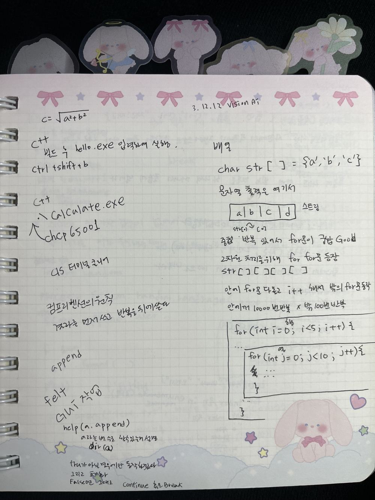
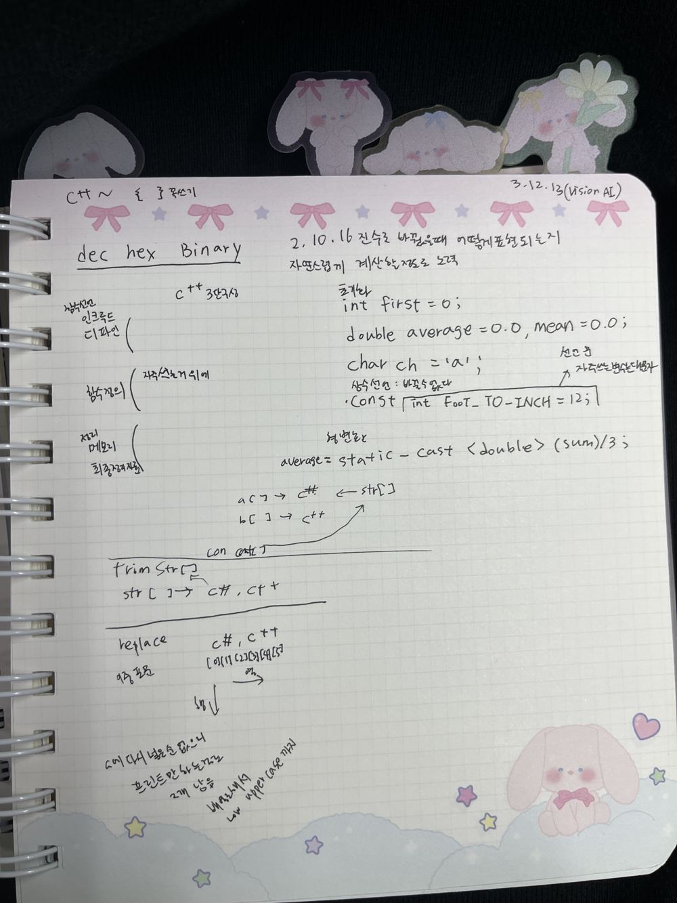
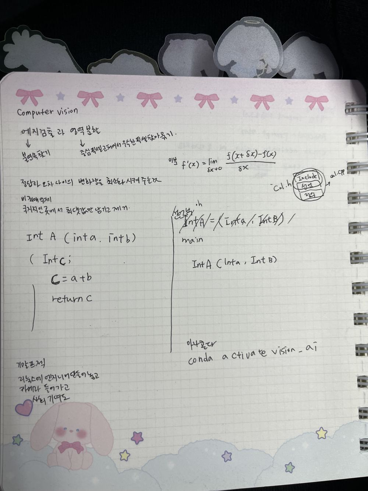

# C++ 수업 손필기 정리

> 금요일 수업 (C++ / Computer Vision / Linux) · VS Code + MinGW g++

## 1. 빌드와 실행

| 작업 | 방법 |
|---|---|
| 빌드 | `Ctrl + Shift + B` |
| 실행 | 터미널에서 `hello.exe` 또는 `.\Calculate.exe` 입력 |
| 한글 깨짐 해결 | `chcp 65001` (UTF-8) |
| 터미널 지우기 | `cls` |

관련: [`00_getting_started/`](../00_getting_started)

## 2. 기본 문법

- `{ }`는 꼭 쓰기
- 2진수, 10진수, 16진수(bin / dec / hex)로 바꿨을 때 어떻게 표현되는지 **자연스럽게 계산할 수 있을 정도로 연습**하기
  → 직접 만든 계산기에서 결과를 2진수·16진수로도 출력해 봄 ([`01_my_projects/calculator`](../01_my_projects/calculator))

**C++ 코드 3단 구성**
1. 상수 선언: `#include`, `#define`
2. 함수 정의: 자주 쓰는 함수는 위에
3. 처리: 메모리 사용, 최종 결과 처리

```cpp
int first = 0;                            // 초기화
double average = 0.0, mean = 0.0;
char ch = 'a';
const int FOOT_TO_INCH = 12;              // 상수: 바꿀 수 없음. 자주 쓰는 상수 이름은 대문자로
average = static_cast<double>(sum) / 3;   // 형변환
```

관련: [`ch03_expressions_types/`](../ch03_expressions_types)

## 3. 배열과 문자열

- `char str[] = {'a', 'b', 'c'};` 문자열은 문자(char)의 배열이다.
- 문자열 연산 실습: 이어 붙이기(concat), 공백 제거(trim), 바꾸기(replace), 대소문자 바꾸기
- 중첩 반복에서는 `for`문이 가장 깔끔하다. 2차원 처리를 위해 `for` 안에 `for`가 등장한다.
- 안쪽 `for`가 다 돈 뒤에 바깥 `for`의 `i++`가 실행된다. (안쪽 10번 × 바깥 5번)

```cpp
for (int i = 0; i < 5; i++) {        // 행
    for (int j = 0; j < 10; j++) {   // 열
        // ...
    }
}
```

관련: [`ch05_repetition/`](../ch05_repetition), [`ch08_arrays/`](../ch08_arrays)

## 4. 함수와 헤더 분리

```cpp
// col.h  → 선언부
int A(int a, int b);

// ai.cpp → 정의부
int A(int a, int b) {
    int c;
    c = a + b;
    return c;
}
```

- 헤더(`.h`)에는 include와 선언을 두고, `.cpp`에 정의를 둔 뒤 `main`에서 호출한다.
- 실습 예: 피타고라스 `c = sqrt(a*a + b*b)`

관련: [`ch06_functions/`](../ch06_functions), [`ch07_classes/circle_project`](../ch07_classes/circle_project) (헤더 분리 + makefile)

## 필기 원본

<details><summary>펼치기</summary>





> 사진 일부에는 같은 날 수업한 Python·Computer Vision 내용도 함께 적혀 있습니다.
</details>
